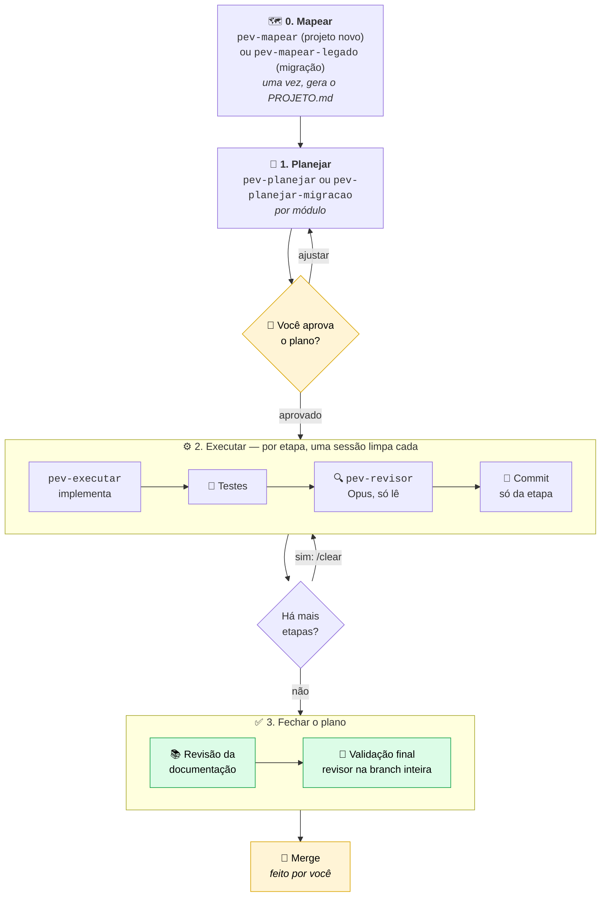

# 🔄 Ciclo PEV

## Planejar · Executar · Validar

---

### Spec-Driven Development simplificado para o Claude Code, feito para **aplicações novas** e **migrações de legados**.

### **Menos tokens. Menos tempo de implementação. Mais controle.**

---

> 🔥 **O desafio:** pegue a próxima funcionalidade do seu backlog e faça com o PEV. Planeje, execute etapa por etapa, valide. Depois compare o consumo de tokens e o tempo de implementação com o seu jeito de trabalhar hoje. Duvida? Então prove. Topa?

> 💡 **A ideia em uma frase:** o **Opus pensa** (planeja e revisa), o **Sonnet faz** (implementa) e **o plano é a memória**: cada etapa roda numa sessão limpa, que sabe onde parou só de ler o plano.

---

## 📖 O que é

O Ciclo PEV é um modo de trabalhar com o Claude Code em que toda funcionalidade passa por três momentos:

- 📝 **Planejar:** a funcionalidade nasce de um **plano aprovado** por você, com decisões rastreáveis, etapas pequenas e critérios de aceite.
- ⚙️ **Executar:** o plano é implementado **uma etapa por vez**, cada uma numa sessão limpa. O plano guarda o estado, então nenhuma sessão depende da memória da anterior.
- ✅ **Validar:** cada etapa é **revisada por um revisor independente** (o agente `pev-revisor`, que só lê) antes do commit, e a branch inteira é revisada no fim.

É uma aplicação simplificada de Spec-Driven Development (veja [referencias.md](referencias.md)): em vez de adotar um framework pesado, o kit traz skills, um agente revisor e um modelo de `CLAUDE.md` que você copia para o projeto.

### 🎯 Os dois cenários do PEV

| Cenário | Quando usar | Como o PEV ajuda |
|---|---|---|
| 🆕 **Aplicação nova** | Você vai construir um sistema ou módulo do zero | Começa pela `pev-mapear`: um questionário (visão, perfis, escopo, **entrada de dados**, **stack de referência**) e os seus documentos de apoio viram o `PROJETO.md`. Depois parte de uma história ou de uma entrevista, apoia-se na **base-backend** e na **base-frontend** e entrega por etapas revisadas |
| 🔁 **Migração de legado** | Existe um sistema antigo que precisa ser reconstruído numa stack nova | Começa pela `pev-mapear-legado`: mapeia o **base-legado**, monta a matriz de cobertura para nada se perder e migra módulo a módulo |

Nos dois cenários o método é o mesmo: **mapear primeiro**, depois plano aprovado, uma etapa por sessão, revisão independente.

## 👥 Para quem

Desenvolvedores e equipes que querem aplicar SDD de forma simples, dentro do próprio Claude Code, sem montar uma infraestrutura nova, e que vão **construir uma aplicação nova** ou **migrar um sistema legado**.

## 🚀 Por que usar

O objetivo do PEV é **diminuir o consumo de tokens e o tempo de implementação**, sem abrir mão da qualidade.

| Ganho | Resultado |
|---|---|
| 💰 **Menos tokens** | sessões limpas, uma etapa por vez, com o plano como única memória |
| ⏱️ **Menos tempo** | planejar uma vez e executar em etapas pequenas evita retrabalho |
| 🎯 **Menos retrabalho** | decisões com fonte; regra de negócio sem fonte não é inventada |
| 🔍 **Qualidade** | nenhuma etapa fecha sem revisão independente |
| 🧠 **Continuidade** | o plano é a memória: retome de qualquer ponto lendo só ele |

## 🧱 Base de código do projeto

O PEV é **agnóstico a linguagem e a tecnologia**: nenhuma skill assume uma stack. Para o Claude não inventar arquitetura nem visual, o projeto reúne, na raiz, até três pastas de referência. O `CLAUDE.md` aponta para elas e o plano as cita como fonte das decisões.

> ✨ **O look and feel do código gerado:** as bases carregam as **regras da casa**. Por isso o código que o Claude produz sai com a cara do seu time: mesma estrutura, mesmos nomes, mesmos padrões de teste e de tela. O objetivo vai além de ter **mais qualidade**: o código fica **fácil de entender e de manter**, porque quem abrir o arquivo reconhece o jeito da casa em vez de encontrar o estilo próprio de uma IA.
>
> 🔁 **Padrão entre projetos:** organizações e desenvolvedores com mais de um projeto passam a manter o mesmo padrão entre eles ao **reaproveitar as bases de código já validadas**. Isso traz mais **segurança** (o que já foi aprovado e testado volta a ser a referência) e mais **performance no desenvolvimento** (menos tempo decidindo estrutura e estilo a cada projeto novo).

> 🧭 **De onde vem a verdade técnica:** a do **sistema novo** (linguagem, arquitetura, padrões, interface) vem da `base-backend/`, da `base-frontend/` e do `CLAUDE.md`, nunca das skills. A do **sistema antigo** é descoberta pelo Claude lendo o próprio legado (manifestos, extensões, convenções), sempre com `caminho:linha`.

| Pasta | Papel | Quando existe |
|---|---|---|
| ⚙️ `base-backend/` | Projeto(s) de referência de arquitetura e boas práticas do back-end, de preferência com testes de unidade confiáveis | **Obrigatória** em todo projeto |
| 🎨 `base-frontend/` | Design System e/ou template de interface do front-end | **Obrigatória** se o projeto envolve front-end |
| 🏚️ `base-legado/` | Código do sistema antigo, **somente leitura**: diz o que o sistema fazia, não como construir | **Obrigatória** em **migração** (`pev-mapear-legado`) |

> 🚧 **As duas skills de mapeamento conferem essas pastas antes de qualquer coisa e param se faltar uma obrigatória.** Não há modo "sem referência": sem a base, o Claude teria de inventar arquitetura e interface. A pasta precisa existir na raiz do repositório, com esse nome exato, e ter arquivos de verdade (um `.gitkeep` não conta).

| Skill | `base-backend/` | `base-frontend/` | `base-legado/` |
|---|---|---|---|
| `pev-mapear` (projeto novo) | ✅ obrigatória | ✅ se tem front-end | não usa (se existir, sugere a `pev-mapear-legado`) |
| `pev-mapear-legado` (migração) | ✅ obrigatória | ✅ se tem front-end | ✅ obrigatória: é o que será mapeado |

Ambas perguntam logo de início se o projeto envolve front-end, para saber se exigem a `base-frontend/`.

### ⚙️ base-backend

Obrigatória em todo projeto. Coloque aqui **projetos de referência que implementem boas práticas**. Escolha os que fizerem mais sentido para o seu projeto, sua equipe e sua organização: pode ser um projeto da própria empresa, um repositório aberto bem avaliado ou um modelo de arquitetura que vocês já adotam. O PEV não impõe uma linguagem nem uma arquitetura; ele segue a referência que você escolheu.

> 🧪 **Dê preferência a projetos de referência que tenham testes automatizados de unidade nos quais o time já confie.** O critério é o que o seu time considera válido, não um número de cobertura. Com testes confiáveis, o Claude aprende o padrão de código **e** o padrão de teste, e a etapa de testes e a revisão do `pev-revisor` passam a ter um modelo concreto do que é "pronto".

### 🎨 base-frontend

Obrigatória quando o projeto envolve front-end (telas e interface). Vale a mesma lógica, voltada à interface:

- **Design System da organização:** se a sua organização tem um, ele é a primeira escolha, porque garante consistência visual e de componentes.
- **Templates de terceiros bem documentados:** sugerimos usar templates prontos com boa documentação, para o Claude consultar componentes, layouts e padrões em vez de criá-los do zero.

### 🏚️ base-legado

Usada **apenas em migrações**, onde é **obrigatória**: a `pev-mapear-legado` mapeia exatamente o que está nesta pasta. Fica em modo somente leitura: o Claude a consulta para levantar o que o legado faz (com `caminho:linha`), mas nunca a altera nem a referencia a partir do código novo.

> 📌 Veja um exemplo real preenchido em [exemplos/senior-manager/CLAUDE.md](exemplos/senior-manager/CLAUDE.md).

---

## 📂 O que há nesta pasta

```
ciclo-pev/
├── README.md              este guia
├── LICOES.md              diário do fluxo: métricas, lições e mudanças
├── referencias.md         ferramentas de SDD que já existem
├── kit/                   o que se copia para um projeto
│   ├── CLAUDE.md.modelo       modelo de CLAUDE.md (postulados + fluxo PEV)
│   ├── .claude/
│   │   ├── settings.json          modelo padrão: opusplan
│   │   ├── agents/pev-revisor.md  o revisor (Opus, só lê)
│   │   └── skills/
│   │       ├── pev-mapear/              iniciar um projeto novo (etapa zero)
│   │       ├── pev-planejar/            planejar módulo novo ou evolução
│   │       ├── pev-planejar-migracao/   planejar a migração de um legado
│   │       ├── pev-executar/            executar uma etapa
│   │       └── pev-mapear-legado/       mapear um legado, em qualquer stack (etapa zero)
│   └── .planning/
│       ├── criterios-base.md      critérios de aceite de todo plano
│       └── historias/             histórias de usuário
└── exemplos/senior-manager/   o fluxo aplicado a um projeto real
    ├── CLAUDE.md                  um CLAUDE.md preenchido
    ├── padroes-telas.md           um arquivo de padrões lido sob demanda
    └── plano-18-financeiro.md     um plano concluído, de ponta a ponta
```

## 🛠️ Como instalar num projeto

1. Copie **o conteúdo** de `kit/` para a raiz do projeto: a pasta `.claude/` e a pasta `.planning/`.
2. Copie `kit/CLAUDE.md.modelo` para a raiz do projeto com o nome `CLAUDE.md` e preencha os `{{ }}`: os postulados, o contexto do produto e os comandos de teste, build e execução. Se o projeto já tem um CLAUDE.md, acrescente o postulado **P5** e as referências.
3. Edite `.planning/criterios-base.md` para o seu domínio: troque os `{{ }}` e apague o que não se aplica.
4. Coloque na raiz do projeto as **bases de referência obrigatórias**: `base-backend/` sempre, `base-frontend/` se há front-end e, em migração, `base-legado/` (veja a seção "Base de código do projeto"). As skills de mapeamento não rodam sem elas.
5. Gere o `.planning/PROJETO.md` com a skill de mapeamento (`pev-mapear` ou `pev-mapear-legado`). Ele traz o roadmap: uma linha por plano (o que é, situação).
6. Abra o Claude Code na raiz do projeto, numa **sessão nova**. Pergunte "quais skills você tem?" para confirmar que as `pev-*` apareceram.

O que o projeto precisa ter para as skills funcionarem: o `CLAUDE.md` com os comandos, a pasta `.planning/` e o git. O resto é opcional (`docs/padroes/` para padrões longos de tela ou arquitetura).

## 🧩 As peças

| Peça | Tipo | Quando usar | Modelo |
|---|---|---|---|
| `pev-mapear` | Skill | Uma vez, no começo de um **projeto novo**: faz um questionário (visão, perfis, escopo, entrada de dados, stack de referência, restrições) e gera o `.planning/PROJETO.md`. Também lê a `base-backend/` e a `base-frontend/` para registrar a stack de referência. Agnóstica de linguagem | Opus |
| `pev-mapear-legado` | Skill | Uma vez, no começo de um projeto existente: mapeia o legado em `.planning/migracao/`. **Funciona em qualquer linguagem:** descobre a stack lendo o próprio projeto, sem lista de tecnologias embutida. | Opus |
| `pev-planejar` | Skill | Para criar o plano de um módulo ou funcionalidade **nova**, ou a **evolução** de um módulo existente. Aceita uma história de usuário como entrada | Opus (modo de planejamento) |
| `pev-planejar-migracao` | Skill | Para criar o plano de **migração** de um módulo que já existe no legado: levanta o que o legado faz, monta a matriz de cobertura e planeja a carga de dados | Opus (modo de planejamento) |
| `pev-executar` | Skill | Para implementar uma etapa de um plano aprovado | Sonnet |
| `pev-revisor` | Agente | Chamado pela `pev-executar` no fim de cada etapa e na Validação final. Só lê, não altera | Opus, sempre |

## 🔀 A ordem do fluxo



> 💡 O diagrama usa [Mermaid](https://mermaid.js.org/), que o GitHub renderiza sozinho. No VS Code, o preview padrão não mostra Mermaid: instale a extensão **Markdown Preview Mermaid Support**.

## 🪜 Passo a passo

### 0. Mapear (uma vez por projeto)

Toda jornada começa aqui e gera o `.planning/PROJETO.md`, que as demais skills leem. Escolha pelo cenário:

| Cenário | Skill | Como pedir (sessão nova) |
|---|---|---|
| 🆕 Projeto novo | `pev-mapear` | "Vamos iniciar o projeto \<nome\>" |
| 🔁 Migração de legado | `pev-mapear-legado` | "Mapeie o legado que está em `base-legado/`" |

#### 🆕 Projeto novo: `pev-mapear`

A skill conduz um questionário em rodadas curtas e só pergunta o que os documentos não respondem:

1. **Documentos de apoio:** ela começa pedindo o que você tiver (briefing, requisitos, regras, histórias, protótipos, modelo de dados, contratos de API, planilhas atuais, normas, atas). **Quanto mais material, menos perguntas e menos palpite.** Cada documento é registrado no `PROJETO.md` com o que fornece e o que não cobre.
2. **Visão, problema e sucesso:** o que é, como se resolve hoje, por que agora e como saber que deu certo.
3. **Usuários e perfis:** quem usa, o que pode e não pode, isolamento de dados e dados sensíveis.
4. **Escopo:** o que a primeira versão faz, o que fica de fora e a ordem dos módulos (o roadmap).
5. **Entrada e saída de dados:** como os dados chegam (telas, importação de arquivos, API, filas, dispositivos, carga inicial), quem fornece, frequência, volume, o que fazer com dado inválido, dados de teste e o que o sistema gera.
6. **Stack de referência:** lê a `base-backend/` e, se o projeto tem interface, a `base-frontend/`, e registra o que elas definem, com `caminho:linha`. Essas pastas são **pré-requisito**: sem elas a skill nem começa o questionário.
7. **Restrições, integrações e riscos.**
8. **Conferência:** ela mostra a leitura dela ("Entendi assim: …") antes de gravar. Campo sem fonte fica "a confirmar".

Ao fim, oferece montar um rascunho do `CLAUDE.md` a partir do modelo e aponta o próximo passo: planejar o primeiro módulo do roadmap.

#### 🔁 Migração: `pev-mapear-legado`

Funciona em qualquer linguagem: a skill descobre a stack lendo o legado.

Gera `.planning/migracao/` e o `PROJETO.md`. A skill identifica a linguagem, o runtime e a ferramenta de build pelos arquivos do legado, e pergunta no fim se a migração mantém a plataforma ou muda para outra (o alvo vem do `CLAUDE.md` e da `base-backend/`).

### 1. Planejar

> **Módulo novo ou migração?** Se o módulo **não existia** no legado, use a `pev-planejar`. Se ele **já existe** no legado e vai ser migrado, use a `pev-planejar-migracao`: ela parte do que o legado faz (com `caminho:linha`), monta a matriz de cobertura para nada se perder e planeja a carga dos dados. O resto do fluxo (executar e validar) é igual.

> **Com ou sem história?** A `pev-planejar` aceita uma **história de usuário** como entrada. Escreva no modelo [historia.md](kit/.claude/skills/pev-planejar/templates/historia.md) e salve em `.planning/historias/<slug>.md`. Serve para módulo novo e para evolução de módulo existente. Com história, a skill a usa como base e pergunta só o que estiver nebuloso; sem história, faz o questionário completo. Preencha só o que souber: o mínimo são Contexto, Objetivo, Quem usa, Histórias e Fora do escopo.

1. Abra uma **sessão nova**.
2. Entre no **modo de planejamento** (Shift+Tab até "plan mode"): o `opusplan` usa o Opus.
3. Peça o plano:
   > Vamos planejar o módulo de \<tema\>

   ou chame direto `/pev-planejar`.
4. A skill lê o `CLAUDE.md` e o roadmap, procura no sistema o que o módulo reaproveita, escolhe as telas-modelo e **faz a entrevista** com você (ou só os pontos nebulosos, se há história).
5. Responda às perguntas. Cada resposta vira uma decisão `D-NNN` com a fonte.
6. Revise o plano mostrado e peça ajustes até ficar bom. Plano com pergunta em aberto não é aprovado.
7. **Aprove.** A skill grava `.planning/plano/NN-<tema>.md` e atualiza o `PROJETO.md`. Se você pedir, também cria a branch `planoNN/<tema>` e faz o commit do plano.
8. Ela para aí, sem implementar.

### 2. Executar (repita para cada etapa)

1. `/clear` ou sessão nova, **fora** do modo de planejamento (Sonnet).
2. Peça:
   > Implemente a próxima etapa de `.planning/plano/NN-<tema>.md`

   ou chame `/pev-executar`.
3. A skill confere a branch e o git, lê o plano inteiro e marca a etapa como 🔄; implementa seguindo as decisões; escreve e roda os testes; chama o **`pev-revisor`** (Opus) e corrige o que ele apontar; marca a etapa como ✅, preenche "Execução" e "Decisões provisórias" no plano; faz o **commit só dos arquivos da etapa**.
4. Leia o relatório: as **decisões provisórias** são escolhas que ela fez sozinha e que você precisa revisar.
5. Volte ao passo 1 para a próxima etapa.

### 3. Fechar o plano (as duas últimas etapas, também com `pev-executar`)

| Etapa | O que faz |
|---|---|
| **Revisão da documentação** | Confere os textos de documentação contra o sistema como ficou: os do módulo e os de telas existentes que mudaram. |
| **Validação final** | O `pev-revisor` revisa a **branch inteira** contra o plano; cada critério de aceite recebe ✅ com a evidência; conferência no sistema rodando; cabeçalho do plano `✅ Concluído`. |

Depois, **o merge é seu**.

## 🚦 Status no plano

| Onde | Estados |
|---|---|
| Cabeçalho do plano | 🟡 Aguardando aprovação → 🔄 Em execução → ✅ Concluído em AAAA-MM-DD |
| Título de cada etapa | ⬜ pendente → 🔄 em andamento → ✅ concluída em AAAA-MM-DD |

## 📋 O que todo plano tem

- **Ponto de partida:** o que o sistema já tem, o legado e as referências externas.
- **Decisões** `D-NNN`, cada uma com a fonte (a sua resposta, a história, uma proposta aprovada ou um plano anterior).
- **Fora do escopo.**
- **Etapas** P, M ou G (G é o máximo que cabe numa sessão), cada uma com entregas, testes, critérios de pronto e Validação.
- **Critérios de aceite:** os do plano e a **lista base** de `.planning/criterios-base.md`.
- **Execução** e **Decisões provisórias**, preenchidas durante a implementação.

## 🏆 Regras de ouro

1. **Uma etapa por sessão** (ou limpe quando a sessão ficar pesada). Contexto limpo é mais rápido, mais barato e erra menos. O plano guarda tudo.2. **Planeje no Opus, implemente no Sonnet.** O `opusplan` faz a troca sozinho pelo modo de planejamento.
3. **Regra de negócio sem fonte não existe.** Se o plano não responde, a skill pergunta; não inventa.
4. **Nenhuma etapa fecha sem o `pev-revisor`.**
5. **Revise as decisões provisórias** no relatório de cada etapa e na Validação final.
6. **Commit só dos arquivos da etapa**, nunca `git add -A`.

## 🆘 Quando algo sai do esperado

| Situação | O que fazer |
|---|---|
| A skill não aparece no menu `/` | Digite o nome inteiro (`/pev-planejar`) ou use a frase normal ("vamos planejar o módulo X"). Confirme que a sessão foi aberta na raiz do projeto e em uma sessão nova. |
| A skill não entrou sozinha | Chame pelo nome: `/pev-planejar` ou `/pev-executar`. |
| O Sonnet errou a mesma coisa duas vezes | `/model opus` nessa sessão e peça de novo. |
| O revisor reprovou duas vezes | A skill para e traz o problema: decida com ela, ou ajuste o plano. |
| O plano está errado ou incompleto | Volte ao modo de planejamento e peça para ajustar o plano antes de continuar a etapa. |
| Uma etapa ficou grande demais | Peça para dividir a etapa no plano; cada parte vira uma etapa nova. |
| Uma sessão ficou longa | Termine a etapa, faça o commit e use `/clear`. |
| Quer saber onde parou | Abra o plano: a primeira etapa sem ✅ é a próxima. |

## 💬 Frases prontas

| Para | Diga |
|---|---|
| Iniciar um projeto novo | "Vamos iniciar o projeto \<nome\>" (ou `/pev-mapear`) |
| Mapear um legado | "Mapeie o legado que está em `base-legado/`" (ou `/pev-mapear-legado`) |
| Começar um plano | "Vamos planejar o módulo de \<tema\>" (no modo de planejamento) |
| Planejar a partir de uma história | "Vamos planejar a partir de `.planning/historias/<slug>.md`" (no modo de planejamento) |
| Planejar uma migração | "Vamos planejar a migração do módulo \<tema\> do legado" |
| Próxima etapa | "Implemente a próxima etapa de `.planning/plano/NN-<tema>.md`" |
| Uma etapa específica | "Implemente a Etapa 2 de `.planning/plano/NN-<tema>.md`" |
| Revisar a documentação | "Faça a revisão da documentação do plano NN" |
| Fechar o plano | "Faça a validação final do plano NN" |
| Revisar algo fora do fluxo | "Use o pev-revisor para revisar \<o quê\>" |
| Ver o custo | `/cost` ou `/usage` |
